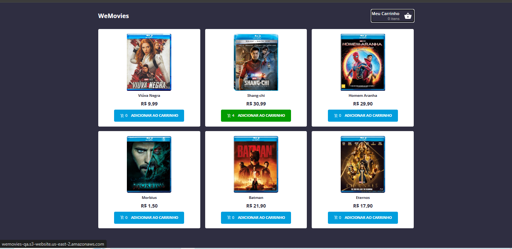
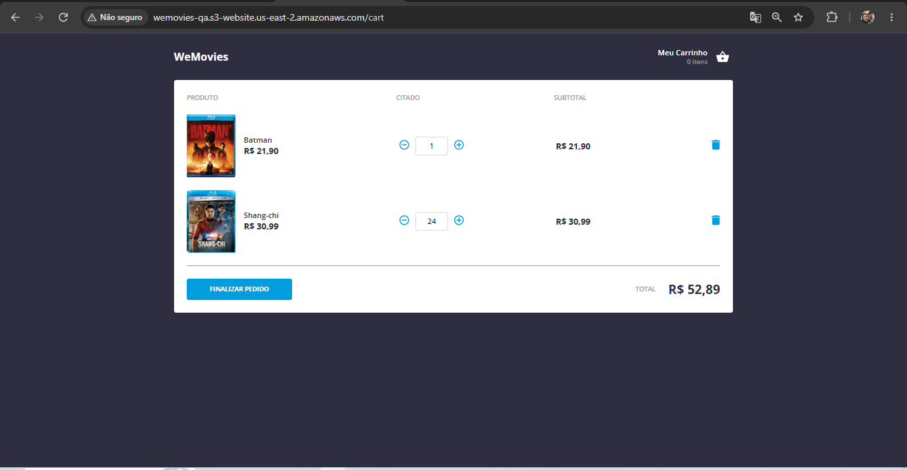
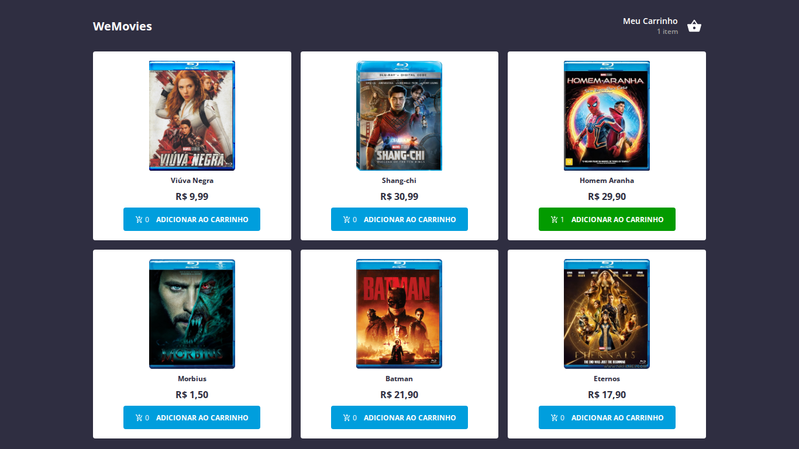
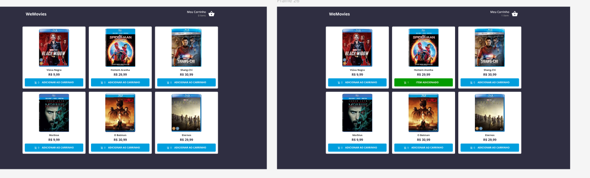
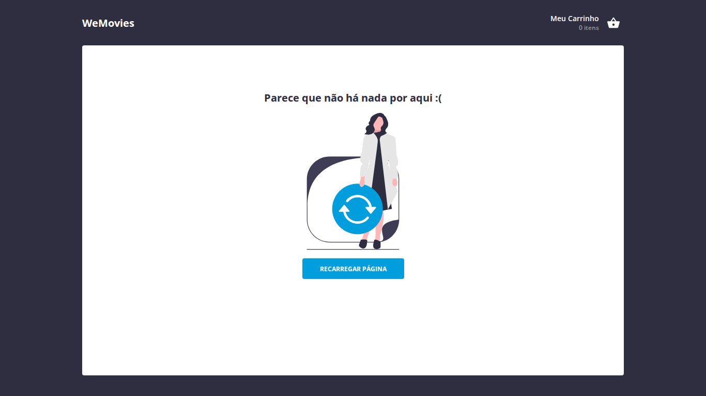
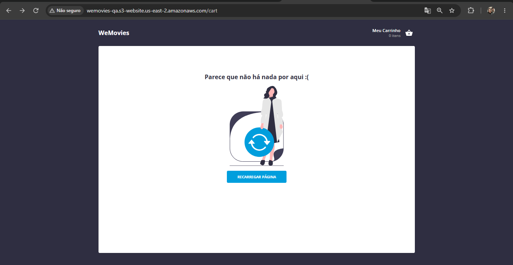

# Bugs, divergências e observações — WeMovies

**Ambiente:** Google Chrome (desktop), Windows 10, 1366x768
**Referência:** protótipo no Figma (Teste Front React WeFit 2022)

| ID | Tipo | Resumo | Severidade |
| --- | --- | --- | --- |
| [B1](#b1--página-declarada-em-inglês-faz-o-chrome-traduzir-e-quebra-a-atualização-da-tela) | Bug | Página declarada em inglês faz o Chrome traduzir e quebra a atualização da tela | Alta |
| [D1](#d1--botão-não-indica-item-adicionado) | Divergência | Botão não indica "Item adicionado" | Baixa |
| [D2](#d2--catálogo-diferente-do-protótipo) | Divergência | Catálogo com preços e nomes diferentes do protótipo | Baixa |
| [D3](#d3--carrinho-vazio-sem-caminho-de-volta-para-a-home) | Divergência | Carrinho vazio sem caminho de volta para a Home | Média |
| [D4](#d4--inconsistência-de-valores-no-próprio-protótipo) | Divergência | Inconsistência de valores no próprio protótipo | Baixa |
| [O1](#o1--botão--remove-o-item-quando-a-quantidade-é-1) | Observação | Botão "–" remove o item quando a quantidade é 1 | — |
| [O2](#o2--título-da-aba-do-navegador) | Observação | Título da aba do navegador | — |

---

## B1 — Página declarada em inglês faz o Chrome traduzir e quebra a atualização da tela

| Campo | Detalhe |
| --- | --- |
| **Severidade** | Alta: o cliente pode ver quantidade e valores errados no carrinho |
| **Telas** | Todas (cabeçalho, Home e Carrinho) |
| **Causa provável** | O HTML declara `<html lang="en">`, mas o conteúdo está em português |

**Passos para reproduzir**
1. Abrir a aplicação no Google Chrome com a tradução automática ativa (ou clicar em "Traduzir" na barra de endereço).
2. Na Home, clicar várias vezes em "Adicionar ao carrinho" no filme "Shang-chi".
3. Observar o cabeçalho "Meu Carrinho".
4. Acessar o carrinho e aumentar a quantidade de "Shang-chi" pelo botão "+".

**Resultado esperado:** o cabeçalho, o subtotal e o total são atualizados a cada ação.

**Resultado obtido**
- O cabeçalho permanece em "0 itens", embora o botão do filme mostre 4.
- No carrinho, "Shang-chi" com **24 unidades** exibe subtotal de **R$ 30,99**, e o total ignora a quantidade.
- O cabeçalho da coluna "Qtd" é traduzido como "Citado".

**Análise:** como a página informa ao navegador que está em inglês, o Chrome oferece (ou aplica automaticamente) a tradução para português. O tradutor substitui os textos da página, e o React deixa de conseguir atualizar esses trechos, então a tela fica com valores antigos. Sem tradução, os mesmos fluxos funcionam corretamente: os testes automatizados rodam num Chrome limpo e passam.

**Sugestão de correção:** declarar o idioma correto (`<html lang="pt-BR">`) e, se necessário, usar `translate="no"` nas áreas com valores dinâmicos.

**Evidências**

---

## D1 — Botão não indica "Item adicionado"

| Campo | Detalhe |
| --- | --- |
| **Severidade** | Baixa (visual) |
| **Tela** | Home |
| **Teste automatizado** | `adicionar-ao-carrinho.spec.ts` › D1 (marcado com `test.fail`) |

**Passos:** na Home, clicar em "Adicionar ao carrinho" em qualquer filme.

**Esperado (protótipo):** o botão fica verde com o texto "ITEM ADICIONADO".
**Obtido:** o botão fica verde, mas mantém o texto "ADICIONAR AO CARRINHO".

---

## D2 — Catálogo diferente do protótipo

| Campo | Detalhe |
| --- | --- |
| **Severidade** | Baixa: os dados vêm da API, mas vale confirmar qual é a fonte de verdade |
| **Tela** | Home |

| Filme no protótipo | Preço no protótipo | Filme na aplicação | Preço na aplicação |
| --- | --- | --- | --- |
| Viúva Negra | R$ 9,99 | Viúva Negra | R$ 9,99 |
| Homem Aranha | R$ 29,99 | Homem Aranha | **R$ 29,90** |
| Shang-Chi | R$ 30,99 | **Shang-chi** | R$ 30,99 |
| Morbius | R$ 9,99 | Morbius | **R$ 1,50** |
| O Batman | R$ 30,99 | **Batman** | **R$ 21,90** |
| Eternos | R$ 29,99 | Eternos | **R$ 17,90** |

Além disso, a ordem dos filmes e as capas são diferentes (o protótipo usa capas em inglês).

---

## D3 — Carrinho vazio sem caminho de volta para a Home

| Campo | Detalhe |
| --- | --- |
| **Severidade** | Média: o usuário fica sem ação clara para continuar comprando |
| **Tela** | Carrinho vazio |
| **Teste automatizado** | `alterar-carrinho.spec.ts` › D3 (marcado com `test.fail`) |

**Passos**
1. Adicionar um filme e acessar o carrinho.
2. Remover o item pela lixeira.
3. Clicar no botão exibido abaixo da mensagem "Parece que não há nada por aqui :(".

**Esperado (protótipo):** botão "VOLTAR", que leva à Home.
**Obtido:** botão "RECARREGAR PÁGINA", que mantém o usuário no carrinho vazio. A única forma de voltar é clicar no logo "WeMovies".

---

## D4 — Inconsistência de valores no próprio protótipo

No quadro do carrinho do protótipo, "Homem Aranha" aparece com preço e subtotal de **R$ 29,99**, mas o total é **R$ 29,90**. Vale alinhar com o time de design qual é o valor correto antes de usar o protótipo como referência de cálculo.

---

## O1 — Botão "–" remove o item quando a quantidade é 1

Ao clicar em "–" num item com 1 unidade, ele é removido do carrinho sem confirmação. O protótipo não define essa regra. Sugestão: confirmar com o PO se esse é o comportamento desejado, ou se o botão deveria ficar desabilitado em 1 (a remoção já é feita pela lixeira).

## O2 — Título da aba do navegador

A aba do navegador exibe "Teste Front React WeFit" em vez do nome da loja ("WeMovies").
